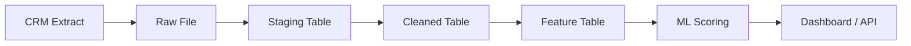

# Data Engineering Architecture Lab

## 175. Draw the pipeline layers

**Question:** Draw the pipeline layers: CRM Extract → Raw File → Staging Table → Cleaned Table → Feature Table → ML Scoring → Dashboard/API

## 176. Define each layer

**Question:** For each layer, define: what data format, what tool handles it, who reads it next

| Layer | Data format | Tool that handles it | Read next by |
|---|---|---|---|
| CRM Extract | CRM export, usually CSV | CRM export process | Raw-file loader |
| Raw File | Immutable CSV, one extract per batch | Python `pandas` and filesystem | Staging-table loader |
| Staging Table | MySQL table preserving source types, including text fields | MySQL and SQL ingestion scripts | Cleaning/curation SQL |
| Cleaned Table | Typed MySQL tables: `customers`, `fact_customer_account`, and dimensions | SQL transformations and validation | Feature-building SQL/Python |
| Feature Table | Typed feature columns in `customer_ml_features` or feature CSV | SQL5 SQL and CP4/CP5 Python | ML scoring service |
| ML Scoring | JSON request/response containing features and risk score | FastAPI and ML model/stub | React dashboard |
| Dashboard/API | JSON over HTTP and rendered React views | FastAPI and React | Business user |

## 177. Identify the two key quality gates

**Question:** Identify the two key quality gates: schema validation (before staging load) and data quality check (before feature build)

**Schema validation, before staging load:** confirm required columns exist, source names are mapped, types are compatible, `customerID` is present and unique within the extract, and enumerated values such as `Contract`, `Churn`, and service fields are valid. Reject the batch and record the failure in the ingestion log if this gate fails.

**Data quality check, before feature build:** confirm cleaned numeric fields contain no unexpected nulls, `monthly_charges` has no nulls, `churn` contains only `0` or `1`, customer IDs are unique, row counts are reconciled, and foreign-key joins do not drop customers. The existing CP5 pipeline asserts the monthly-charge and churn checks before saving outputs.

## 178. Define the incremental processing question

**Question:** Define the incremental processing question: what happens when the same customer appears in two consecutive daily extracts?

Each daily extract receives a `batch_id`, extract date, file name, and load timestamp. The customer ID is the business key. The raw file and staging rows are retained for audit, while the cleaned and feature tables use an upsert/merge:

- New customer ID: insert a new record.
- Existing customer with unchanged values: keep the current record and mark the incoming row as unchanged.
- Existing customer with changed values: update the current record with the latest extract and record the previous version or change event.
- Duplicate customer ID within one batch: reject the batch or quarantine the duplicate rather than silently choosing a row.

This prevents a customer appearing in two consecutive extracts from becoming two customers in the curated or feature tables.

## 179. Map each layer to the labs

**Question:** Map each layer to the labs that implement it: CP5 handles layers 1–3, DE2 formalises ingestion, DE3 formalises cleaning, etc.

| Pipeline area | Lab implementation in this repository |
|---|---|
| CRM extract, raw file, and initial pipeline flow | CP5: `Phase_1/customer_pipeline.py` |
| Ingestion logging, staging inspection, and duplicate checks | DE2 equivalent: `Phase_2/LAB_SQL2.sql` (questions 54–58) |
| Cleaning and curated customer/fact tables | DE3 equivalent: `Phase_2/LAB_SQL3.sql` (questions 59–64) and `Phase_1/customer_cleaner.py` |
| Churn analytics and business queries | `Phase_2/LAB_SQL4.sql` (questions 67–73) |
| ML feature table | `Phase_2/LAB_SQL5.sql` (questions 74–82) and CP4/CP5 feature engineering |
| Rule-based high-risk view | `Phase_2/LAB_SQL6.sql` (questions 83–89) |
| ML scoring and API delivery | `Phase_3/main.py` (questions 119–131) |
| Dashboard consumption | `Phase_4/customer-dashboard` |

## 180. Produce a one-page architecture document

**Question:** Produce a one-page architecture document: layer diagram + tool mapping + quality gate definitions

The pipeline extracts customer data from the CRM as daily CSV batches, preserves each batch as a raw file, validates its schema, and loads it into a MySQL staging table. Cleaning and type conversion produce curated customer, fact, and dimension tables. A second data-quality gate runs before feature construction, which produces the ML feature table. The scoring API reads those features or receives prediction inputs, returns a risk score, and the React dashboard renders the result. Batch IDs, load timestamps, ingestion logs, primary-key checks, and upsert rules make the process repeatable and prevent duplicate customers during incremental loads.
